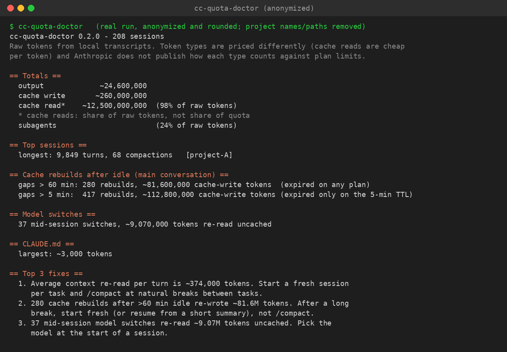

# cc-quota-doctor

**Find out why Claude Code is eating your quota, using only the transcripts already on your machine.**

Usage counters tell you *how much* you used. `cc-quota-doctor` tells you *where it went* (cache reads, idle cache rebuilds, subagents, huge tool outputs, a bloated CLAUDE.md) and ends with the top 3 fixes for your own usage. It runs offline, needs no dependencies, and uploads nothing.



## Install
Requires Python 3.9+ (Windows, macOS, Linux).
```
pip install git+https://github.com/raunakpathak20/cc-quota-doctor-.git
```
Or without installing:
```
git clone https://github.com/raunakpathak20/cc-quota-doctor-.git
cd cc-quota-doctor-
python -m cc_quota_doctor
```

## Usage
```
cc-quota-doctor                         # reads ~/.claude/projects
cc-quota-doctor --top 10                # show more projects/sessions
cc-quota-doctor --json > usage.json     # machine-readable
cc-quota-doctor --idle-minutes 5        # API key / usage credits (5-min cache TTL)
cc-quota-doctor --share --out share.json  # redacted, numbers-only report you can send to someone
cc-quota-doctor --projects-dir PATH --home PATH
```
On Windows, the default `~` resolves to `%USERPROFILE%`.

## What it reports
- tokens per project and per session: input, output, cache write, cache read
- the subagent share (sidechain messages and `subagents/` transcripts)
- first-turn ("startup") context size per project
- CLAUDE.md files that load at startup, with size estimates
- cache rebuilds after idle gaps, reported at both TTLs: over 60 min (the main-conversation TTL on a Claude subscription) and over 5 min (the TTL for API keys, usage credits, subagents and compaction). `--idle-minutes` sets which one drives the fixes (default 60)
- mid-session model switches (each makes the next request re-read the history uncached) and compactions
- the largest tool outputs
- the **top 3 fixes**, ranked by API-price-weighted tokens (cache reads count 0.1x, cache writes 1.25x). This weighting is only for ranking; it is not how plan limits are calculated

## Sample output
The screenshot above is a real run on one developer's history, anonymized and rounded, with project names and paths removed. Here's where the tokens went:

| | |
|---|---|
| Sessions | 208 |
| Longest session | 9,849 turns, 68 compactions |
| Cache rebuilds after > 60 min away | 280, ~81.6M cache-write tokens |
| Cache rebuilds after > 5 min away (only matters on the 5-min TTL) | 417, ~112.8M |
| Mid-session model switches | 37, ~9.07M tokens re-read uncached |
| Average context re-read per turn | ~374k tokens |
| Output / cache write / cache read | 24.6M / 260M / 12.5B |
| Subagents | 24% of raw tokens |
| Largest CLAUDE.md | ~3k tokens |

Cache reads are 98% of the *raw* tokens here. That isn't 98% of the quota: cache reads are cheap per token, and Anthropic doesn't publish how each token type counts against plan limits.

## Share mode (redacted report)
`cc-quota-doctor --share --out share.json` writes a numbers-only JSON report that you can paste into an issue or send to someone helping you.
- **Included:** token totals, counts (sessions, turns, idle rebuilds, model switches, compactions), CLAUDE.md sizes, tool-output sizes per built-in tool, model ids, the date range (days only) and the suggested fixes.
- **Not included:** file paths, project or folder names, session ids, prompts, replies, code, tool inputs or outputs, CLAUDE.md contents, or per-message timestamps. Projects show up as `Project A`, `Project B`, ... (largest first) and sessions as `S1`, `S2`, .... MCP and custom tool names become `mcp` / `other`.
- **Self-check:** before writing anything, it scans the report for your project paths, folder names, home directory and session ids. If it finds one, it writes nothing and exits with code 3.
- Use `--out` instead of `>` on Windows PowerShell, so the file is saved as UTF-8. Open the file and read it before you send it.

## Honest limits
- **It does not bypass, reset or raise any limit.** It only shows where tokens go.
- **It cannot show your plan %.** Anthropic doesn't publish how each token type counts toward plan limits. A high cache-read share is a share of raw tokens, not of your quota: cache reads are cheap per token. Compare `/usage` before and after a change yourself.
- **The transcript format is undocumented** and may change. Unknown lines are skipped; please open an issue if numbers look off.
- **Some numbers are estimates.** Tool-output and CLAUDE.md sizes are characters / 4. "Idle rebuild" means a main-conversation cache write of more than 5k tokens after a gap longer than the threshold. The tool can't tell which TTL you were on, so it reports both.
- Streamed responses repeat usage lines; they are de-duplicated by message id + request id.

## Privacy
It makes no network calls. It reads files and prints to your terminal. The code is a few hundred lines of standard-library Python, so you can check that.

## Tests
```
python -m unittest discover -s tests
```
Tests use synthetic transcripts generated by `tests/make_sample.py`, never real data.

## Pro kit (optional)
If you want the fixes ready-made: a weekly trend report, a CLAUDE.md-slimming skill, lean templates, warning hooks and a playbook, for $19. [Get the Pro kit (USD 19)](https://buy.polar.sh/polar_cl_69l29e1HavMF0OIreYDVgqTqPzCPoZjy3QAvI4ZK6Jb).
The kit also includes `quota-audit`, which writes a personalised quota-audit report (Markdown + PDF) offline from your own logs and CLAUDE.md: [Pro kit on Polar](https://buy.polar.sh/polar_cl_69l29e1HavMF0OIreYDVgqTqPzCPoZjy3QAvI4ZK6Jb).
The free CLI is the complete diagnostic; the kit is optional.

## How it was built
I built this with an AI agent after noticing my own Claude Code limits draining. I reviewed it and ran it on my own history.

## License
MIT

## References
- Prompt caching in Claude Code (TTL per plan, model switches, /compact cost): https://code.claude.com/docs/en/prompt-caching
